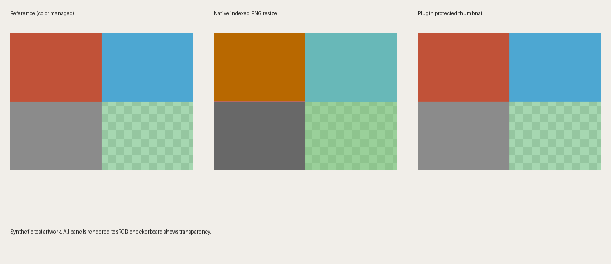

# Lean Uploads

A WordPress plugin that converts every uploaded image to WebP (or AVIF), scales it down to a sane maximum size, and generates all the thumbnails in the same format. The original upload is replaced, not kept alongside.

## Why I built it

Every "image optimizer" plugin I've tried makes the same timid choice: it adds a WebP copy next to the original and leaves the original in place. So the Media Library still hands out the 3MB PNG whenever someone copies an image URL, the uploads folder doubles in size, and the host keeps billing for it. Even WordPress core's own WebP support only touches the generated sizes, never the file you uploaded.

That caution comes from treating WordPress as an archive. It isn't one. The file you upload to a website is a display copy; your source files live in Lightroom, Figma, a NAS, wherever you made them. Once you accept that, the right behavior is obvious: convert on the way in, cap the dimensions, throw the original away. WebP at quality 75 is visually indistinguishable from a JPEG for photos at a third of the size, and it handles transparency, so there's no reason for a PNG to ever land in `wp-content/uploads` again.

So this plugin does that, by default, for everyone, and gives you an escape hatch for the rare file that really does need to stay as uploaded.

## What it does

- **Converts originals.** JPEG, PNG, BMP, TIFF and HEIC (where the server can decode it) become WebP (or AVIF where the server can encode it). Works for the Media Library, the block editor, the REST API, `media_sideload_image()`, and `wp media import`, because all of them end in the same core function that generates image sizes.
- **One generation, never two.** WordPress cuts the converted full-size image and every thumbnail from the uploaded original, each one encode away from the source. Only then is the original deleted. Thumbnails are never made from the already-compressed full size.
- **Caps dimensions, efficiently.** Anything larger than the maximum (default 2560px, the same threshold WordPress uses for its `-scaled` copies) is resampled once, losslessly, to the cap, and everything is derived from that. A 60-megapixel upload is decoded exactly once; on hosts where Imagick cannot hold an untagged image, GD can do that decode. Tagged images never silently fall back to GD. Set the cap to 0 to disable.
- **Thumbnails in the same format.** Every registered image size is generated as WebP/AVIF at the same quality, including for images that were uploaded before the plugin.
- **Color-profile safeguards beyond native WordPress defaults.** Preserves embedded ICC profiles by default through conversion, temporary resized images and generated thumbnails, then reopens saved files to verify the required profile. This addresses profile loss in core PNG resizing and GD processing; unsupported or unsafe operations retain the source and report a failure. It is a targeted safeguard, not a guarantee of identical colors on every screen.
- **Optional sRGB normalization.** Convert tagged non-sRGB uploads using a real color transform, or normalize selected existing attachments from the Media Library and WP-CLI. Existing-file normalization keeps URLs, formats and dimensions, checks each registered image independently and skips untagged or identified sRGB files.
- **Metadata handled the WordPress way.** EXIF orientation is applied during upload conversion, and IPTC/EXIF title, caption and camera data are read into the attachment before the original goes. Non-color metadata follows the existing conversion path; same-format color normalization retains existing metadata and orientation.
- **Already-efficient uploads are left alone.** WebP and AVIF are only re-encoded when they exceed the cap or when opt-in sRGB normalization is needed. SVG is never touched. Animated GIFs are never touched.
- **An opt-out that teaches.** Put `--keep` anywhere in a file name and that file is stored exactly as uploaded, with the token removed from the saved name. `logo--keep.png` becomes `logo.png`, untouched, and its thumbnails stay PNG too. The attachment is flagged so later regenerations respect it.
- **Avoids unnecessary larger files.** If the converted file wouldn't be smaller and nothing was resized or deliberately color-normalized, the original is kept (filterable). Images above 120 megapixels are left alone rather than risk PHP's limits.
- **Never blocks an upload.** If conversion fails for any reason, the original is kept and the uploader sees a notice saying so.
- **Media Library integration.** A Format column shows each image's type and size with a one-click Convert link, plus a bulk action for selected images (25 per request; the Tools page is for whole libraries).
- **Bulk conversion of the existing library**, from Tools > Lean Uploads (scan, then convert in batches with a progress bar, pause and resume, dry run) or from WP-CLI. Each image is its own transaction. Old URLs in posts, meta and options can be rewritten to the new files; that rewrite is serialization-safe and never unserializes stored data (it walks the serialized format and fixes string lengths), so it cannot be used to instantiate objects.

## Install

Download the repository as a zip (or clone it into `wp-content/plugins/lean-uploads`), activate it under Plugins, and run `wp lean-uploads self-test` if you have WP-CLI. From then on every new upload is converted. Existing images are untouched until you convert them from Tools > Lean Uploads, the Media Library, or WP-CLI; do a dry run first, and have a backup, because originals are replaced.

## Settings

Under **Settings > Media**. There are intentionally few:

| Setting | Default | Notes |
|---|---|---|
| Convert uploads | on | The master switch for originals. |
| Output format | WebP | AVIF is offered when the server's image library can write it, and is only used if you choose it. Falls back to WebP if it turns out to be unavailable. |
| WebP quality | 75 | Lossy quality for WebP originals and thumbnails. |
| AVIF quality | 60 | AVIF's scale differs; 60 looks about like WebP 75. Only applies when AVIF is the output format. |
| Enforce quality | on | Give Lean Uploads WebP/AVIF quality priority over theme and plugin default-quality filters during its image processing. Turn off for cooperative filter behavior. |
| Color profiles | preserve | Preserve embedded ICC profiles, or opt into true sRGB conversion when needed. Tagged processing requires Imagick; conversion to sRGB also requires LittleCMS. |
| Maximum dimension | 2560 px | Longest side. 0 disables. |
| Source formats | JPEG, PNG, BMP/TIFF on; GIF off | Lossless PNG conversion is available when Imagick is present. |
| Thumbnails | on | Generate all sizes in the output format. |
| Opt-out token | `--keep` | Empty disables the escape hatch. |

Developers get filters `lean_uploads_settings` (override any setting in code), `lean_uploads_keep_smaller_original` and `lean_uploads_max_pixels`, and actions `lean_uploads_converted` (an upload's original was replaced), `lean_uploads_attachment_converted` (an existing attachment was converted, with the old/new URL pairs) and `lean_uploads_failed`.

Quality enforcement applies to uploads, generated sizes and bulk conversions. It does not alter JPEG quality or unrelated image editors. Explicit operation-specific quality wins over the site default; lossless PNG conversion and WordPress's lossless WebP handling retain their lossless intent. With enforcement off, later WordPress filters may override quality, including when a fallback conversion switches formats. Direct Imagick operations still use their explicit encoder settings. This is filter precedence, not protection against code that re-encodes images itself or installs a competing final filter during processing. Existing files are not re-encoded just by changing the setting.

Uninstalling removes the plugin's options, on every site of a network. Converted images stay converted; there is nothing to restore them from.

## How it compares

I looked at the established plugins (Smush, ShortPixel, EWWW, Imagify, WebP Express, Converter for Media, and core's Modern Image Formats) before writing this. They all keep the original and add converted copies beside it, and most serve those copies through server rewrite rules or `<picture>` markup. Several have genuinely good ideas this plugin borrows: EWWW's "never create a larger image" rule, upload-time resizing, a Media Library column with per-image actions, WP-CLI for big libraries. What it deliberately does not borrow is the backup-and-restore machinery, because the premise here is that the uploaded file was never the master copy.

## WP-CLI

```bash
wp lean-uploads status
wp lean-uploads self-test
wp lean-uploads scan
wp lean-uploads convert --all --dry-run
wp lean-uploads convert --all --update-references
wp lean-uploads convert --all --limit=50
wp lean-uploads convert 123 456
wp lean-uploads normalize-srgb --all --dry-run
wp lean-uploads normalize-srgb 123 456
```

`self-test` pushes generated images through the real upload pipeline into the Media Library, checks the results (format, extension, dimensions, thumbnail formats, opt-out), and deletes everything it created. Run it after activating on a new host.

`scan` is the Tools page summary in text form. `convert` replaces each attachment's file in place, regenerates its sizes, deletes the old files, and with `--update-references` rewrites every old URL (original and each size) to the new one in the site's posts, meta and options; `--limit` stops after that many conversions, handy for doing a large library in sittings. Do a `--dry-run` first and have a backup; this is a one-way door by design. The Tools page does the same thing in batches of five from the browser, and is the better choice for anyone without shell access.

## Color consistency



[Reproduce this example and inspect the saved files](docs/color-consistency.md). The native indexed-PNG path shown here loses RGB and alpha precision; the plugin preserves it. This is separate from the missing-profile problem.

The default is **preserve**, not forced sRGB. The optional sRGB mode performs a source-profile-to-sRGB pixel transform through LittleCMS; merely attaching an sRGB label would be incorrect. It applies during new uploads and explicit format conversions. A separate **Normalize colors to sRGB** row action and selected bulk action in the Media Library handle existing files, independently of the automatic setting. The bulk action handles 25 attachments per request; `wp lean-uploads normalize-srgb --all --dry-run` previews an entire library.

Only tagged files needing normalization are processed. Known sRGB profiles are identified by color characteristics, not their name. Untagged files are left untouched, including old thumbnails whose profiles were previously stripped. Nonstandard PNG color declarations without a usable ICC profile are refused rather than silently discarded. Invalid profiles, unsupported profile/container combinations, unavailable color engines and failed saved-profile validation are reported; an unsafe GD fallback is blocked. The upload opt-out remains respected. These safeguards cover plugin-owned processing, not arbitrary third-party image rewrites. ICC-free AVIF/HEIC color declarations (such as NCLX/HDR signaling) are not covered by the ICC-preservation guarantee.

Same-format normalization stages and validates all eligible attachment files before replacing them, with rollback on a handled failure. It preserves PNG/WebP pixels losslessly after the color transform; JPEG and AVIF must be re-encoded (quality 100) and files can grow. Wide-gamut colors outside sRGB may be clipped. Keep external masters and purge any image/CDN caches after normalizing existing URLs. Historical WordPress image-editor backup files are left alone. An interrupted process retains a recovery journal and original files; an administrator must verify or restore those files before clearing the attachment's processing lock.

The specific native-WordPress comparison is profile integrity: [core's PNG resizing excludes ancillary chunks, while GD strips profiles](https://developer.wordpress.org/reference/classes/wp_image_editor_imagick/thumbnail_image/). Lean Uploads explicitly preserves ICC data at save time and validates the saved result. This is not a claim that every WordPress image loses its profile, that every visual change is a profile issue, or that this plugin outperforms other optimizers' color handling. No comparative color test of other plugins has been performed.

Profile validation detects missing or changed required ICC data cheaply. It does **not** compare image appearance. A color-managed pixel comparison can flag suspicious shifts, but needs the exact resize/crop reference and allowances for alpha, lossy encoding and gamut conversion. Such an advisory audit remains a separate future feature, not an automatic rejection rule in this version.

## Requirements

WordPress 6.5 or newer, PHP 7.4 or newer, and an image library that can write WebP: Imagick or GD, which nearly every host has. AVIF needs a newer Imagick or GD build. The plugin refuses to activate if it can write neither format, rather than silently doing nothing.

It uses WordPress's own image editor for the actual encoding, with a protected Imagick editor for tagged images. Untagged processing respects the `wp_image_editors` filter; tagged processing requires the verified color-capable path and does not silently accept a GD-only override. Nothing depends on the web server: no `.htaccess` rules, no nginx config, no CDN cooperation. That's deliberate; hosts that serve static files straight from nginx (WP Engine, among others) break every rewrite-based WebP plugin, and this one doesn't care.

## Safety properties

- Originals are only removed for attachments the plugin was explicitly handed: new uploads, and attachments you convert through its own Media Library actions or WP-CLI command. Regenerations triggered any other way (core's own "create image subsizes" request, regeneration plugins, `wp media regenerate`) get thumbnails in the output format but never lose their original. That matters because core lets any user who can upload files trigger a regeneration of any attachment.
- Every delete and rename is confined to the uploads directory, and file names from attachment metadata are reduced to their base name before use.
- Target file names are claimed exclusively before anything is renamed over them, so two uploads differing only by extension cannot overwrite each other.
- A new upload never reuses the base name of an earlier upload that was converted. Core only checks for existing files with the uploaded extension, so without this a second `photo.jpg` would get its thumbnails written over the first one's `photo-300x200.webp`.
- An oversized original is moved aside, not replaced, while its lossless stand-in is processed; a failed conversion puts it back byte-for-byte.
- If no thumbnails can be made for a converted image, the original is kept beside it rather than deleted.
- Bulk conversion is a transaction per attachment: if regeneration comes back incomplete, the previous metadata is restored and no file is deleted. A converted file that has become the only copy is never deleted either.
- URL rewriting touches only URLs under the uploads URL, stops at name boundaries, walks serialized data with a bounded depth, and never unserializes anything. One known limit: a serialized blob pasted inside plain text (a shortcode attribute, say) is rewritten as text, which would leave its string lengths stale.
- Failure notices show the file name only; technical detail goes to the error log (when `WP_DEBUG` is on) and the `lean_uploads_failed` action.

## What it doesn't do

- It doesn't optimize images referenced by URL in pasted HTML. If someone hotlinks a 6000px JPEG from somewhere else, that's still a 6000px JPEG.
- It doesn't keep the original. That is the point, but read it twice before enabling on a site where someone has been using the Media Library as the only copy of their photos. The `--keep` token and the "Convert uploads" switch are there for the transition.
- It cannot reconstruct a color profile that was already removed, infer the intended colors of an untagged file, or promise color matching between different displays.

## Development

```bash
composer install
composer test
```

Unit tests cover decision logic, settings sanitization, quality policy and the URL rewriter without needing a WordPress install. Against a real site there is `wp lean-uploads self-test`, plus WP-CLI scripts in `tests/integration/` that exercise upload, bulk and rewrite paths end to end (they create their own fixtures and delete only those).

Run `wp eval-file wp-content/plugins/lean-uploads/tests/integration/verify-quality.php` on an Imagick test site to check quality precedence, opt-out, full-size and thumbnail encoding, bulk conversion, explicit fallback quality and lossless behavior. It creates and removes its own fixtures and never saves settings. It reports a skip if the required encoder is unavailable.

## Status

Early. It's been exercised on two hosts (WP Engine and a self-managed CloudPanel VPS, both Imagick, WordPress 7.1): the self-test, WP-CLI imports, the bulk converter with URL rewriting, and real uploads through the browser uploader. I'd particularly like to hear from anyone on a GD-only host, or where the activation check refuses to run.

License: GPL-2.0-or-later.
