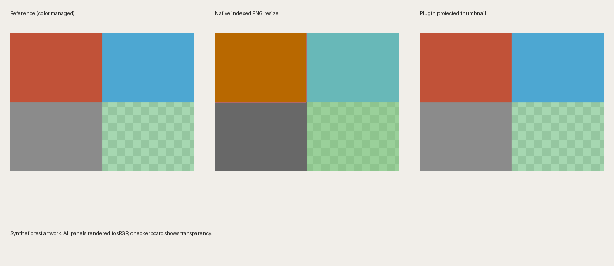

# A reproducible color-consistency example



This synthetic example shows a specific native WordPress resizing failure and the corresponding Lean Uploads correction. It does not establish that every WordPress image changes color, or compare other image-optimization plugins.

The left panel is the original rendered through its embedded ICC profile into sRGB. The middle panel is the output of the native `WP_Image_Editor_Imagick` resize. The right panel is the output of Lean Uploads' protected WordPress thumbnail editor. Each panel is rendered to sRGB for this comparison; the checkerboard exposes differences in transparency.

## What went wrong

The source is an 800×600 indexed PNG with four RGB/alpha patches and a synthetic gamma-1.8 RGB ICC profile. Its palette indices need only two bits, but its palette entries have eight-bit RGB values. During resizing, the tested WordPress/ImageMagick path reused the two-bit index depth as pixel-channel depth. The red patch changed from RGB `(180, 65, 42)` to `(170, 85, 0)` before color management, and a half-transparent patch became more opaque.

**The native Imagick output still contained the original ICC profile in this particular example.** The problem was loss of pixel precision, not missing ICC data. Lean Uploads establishes at least eight-bit channel precision for tagged indexed PNGs before the core resize, and verifies the saved file's profile afterward. The original RGB and alpha patch values survive this protected path.

This differs from the separate profile-loss issue: native GD processing of the same fixture removed its ICC profile. Core PNG ancillary-chunk exclusion can also suppress ICC on other resize paths. Those are addressed through profile-aware editor selection, safe save settings and verification of the actual saved output.

## Verification

Snapshot tested with WordPress 7.1.4, PHP 8.4.27, and ImageMagick 7.1.2-34 Q16-HDRI. The protected converter suite also passed under PHP 8.2.35. Files were independently reopened and color-managed using Pillow/LittleCMS, in addition to the PHP checks.

For the four interior patch samples, on a 0–255 scale:

| Saved output | Maximum RGB difference from color-managed reference | Maximum alpha difference |
|---|---:|---:|
| Native WordPress Imagick PNG | 56 | 42 |
| Native WordPress GD PNG | 19 | 1 |
| Lean Uploads protected PNG thumbnail | 0 | 0 |
| Lean Uploads direct PNG / lossless WebP | 0 | 0 |
| Lean Uploads AVIF at quality 85 | 1 | 0 |
| Lean Uploads same-format sRGB PNG conversion | 0 | 0 |

These are patch-sample measurements, not a whole-image perceptual score or a universal tolerance for photographs. The small AVIF difference is normal lossy encoding. Newer WordPress or image-library versions may behave differently.

The [source PNG](color-example/source.png), [native Imagick output](color-example/native-imagick.png), [native GD output](color-example/native-gd.png), [protected output](color-example/protected-thumbnail.png), and [independent measurements](color-example/verification.json) are retained. All imagery and ICC fixtures are generated; no client image or device profile is included.

## Reproduce

Use a disposable WordPress installation with Lean Uploads active and Imagick/LittleCMS available. From the plugin directory, choose a new output directory:

```sh
wp eval-file tests/integration/export-color-example.php /tmp/lean-color-example
uv run --with pillow python tests/render-color-example.py /tmp/lean-color-example /tmp/lean-color-render
```

The PHP script creates the source and real saved outputs without creating attachments or changing settings. It refuses an existing output directory. The renderer validates plugin sample colors, profiles and transparency, then generates the comparison and measurements. Native outputs are reported as observations so a future WordPress fix does not make the example generator fail. AVIF output is optional when its encoder is unavailable.

The synthetic ICC generator is in `tests/fixtures/make-profiles.c`. The automated regression for the indexed-PNG precision error is in `tests/integration/verify-color-converter.php`.
